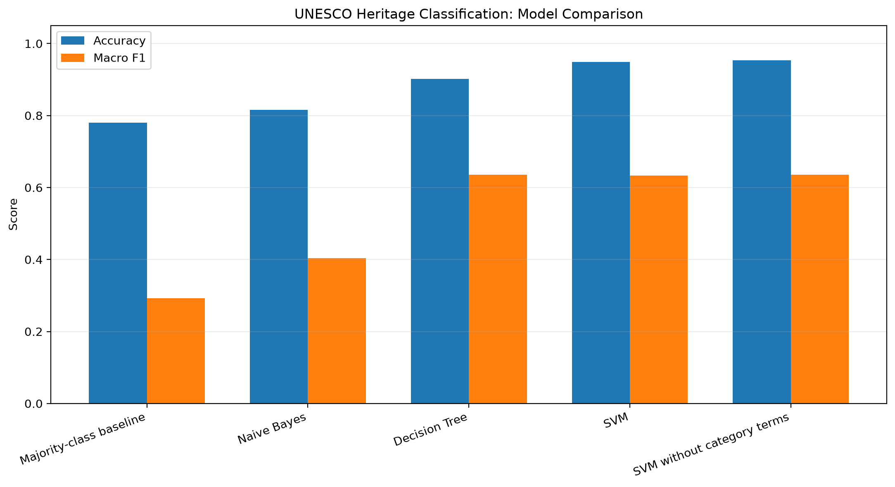
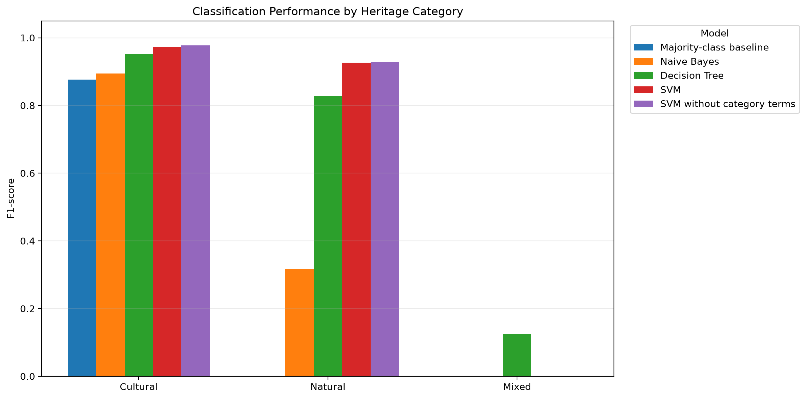

# UNESCO World Heritage Text Classification

**A cultural heritage informatics project using Python and data mining**

## Project Overview

This project investigates whether English descriptions of UNESCO World Heritage properties can be used to predict their official heritage categories: Cultural, Natural, or Mixed.

It applies data collection, data quality assessment, text preprocessing, TF-IDF feature representation, and classification methods to a cultural heritage dataset. It also examines how class imbalance affects model evaluation and the reliability of automated classification.

## Research Question

How effectively can textual descriptions of UNESCO World Heritage properties predict their official heritage categories, and what limitations emerge when evaluating underrepresented categories?

## Dataset

The dataset was collected programmatically from the official UNESCO World Heritage List API.

- **Original records retrieved:** 1,273
- **Fields returned per record:** 55
- **Records retained for classification:** 1,272
- **Records excluded:** 1, due to a missing English description

The analysis dataset contains the following category distribution:

| Official category | Records | Percentage |
|---|---:|---:|
| Cultural | 990 | 77.83% |
| Natural | 240 | 18.87% |
| Mixed | 42 | 3.30% |
| **Total** | **1,272** | **100.00%** |

The category distribution is imbalanced, with Mixed properties accounting for only 3.30% of the analysis dataset.

**Data source:** [UNESCO World Heritage List — DataHub](https://data.unesco.org/explore/assets/whc001/)

## Methods

The project uses Python, pandas, requests, scikit-learn, and Matplotlib.

The workflow follows these stages:

1. **Data collection:** Retrieve UNESCO records through the official API using Python requests.
2. **Data quality assessment:** Inspect the data structure, missing values, blank descriptions, and duplicate identifiers.
3. **Data preprocessing and exploration:** Compare description fields, investigate missing descriptions, and examine description lengths and category distributions.
4. **Text representation:** Experiment with word-count vectors and TF-IDF to represent textual descriptions numerically.
5. **Train-test split:** Divide the analysis dataset into 80% training records and 20% testing records using stratified sampling and a fixed random seed.
6. **Classification:** Compare a majority-class baseline, Naive Bayes, Decision Tree, and Support Vector Machine (SVM).
7. **Evaluation:** Examine accuracy, precision, recall, F1-scores, and confusion matrices.
8. **Error analysis:** Investigate misclassified Mixed properties and explore the effect of removing selected category-related terms from descriptions.

## Results

All approaches were evaluated on the same 255-record test set. The table reports accuracy, macro F1, and F1-scores for each heritage category.

| Model | Accuracy | Macro F1 | Cultural F1 | Natural F1 | Mixed F1 |
|---|---:|---:|---:|---:|---:|
| Majority-class baseline | 0.780 | 0.292 | 0.877 | 0.000 | 0.000 |
| Naive Bayes | 0.816 | 0.403 | 0.894 | 0.316 | 0.000 |
| Decision Tree | 0.902 | 0.635 | 0.952 | 0.828 | 0.125 |
| SVM | 0.949 | 0.633 | 0.973 | 0.926 | 0.000 |
| SVM without category-related terms | 0.953 | 0.635 | 0.978 | 0.928 | 0.000 |

### Model Comparison

### Performance by Heritage Category

## Key Findings

- **Highest accuracy:** The SVM experiment without selected category-related terms achieved 95.3% accuracy, compared with 94.9% for the original SVM. This small difference was observed on one test split.
- **Macro F1:** The Decision Tree and SVM without selected category-related terms both achieved a macro F1-score of approximately 0.635.
- **Cultural and Natural categories:** The SVM models performed strongly on both categories, with F1-scores above 0.92.
- **Mixed category:** All approaches except Decision Tree failed to identify any Mixed properties in the test set. Decision Tree correctly identified only one of the eight Mixed test records, producing a Mixed F1-score of 0.125.
- **Category-related terms:** Removing selected terms produced only a small change in overall performance and